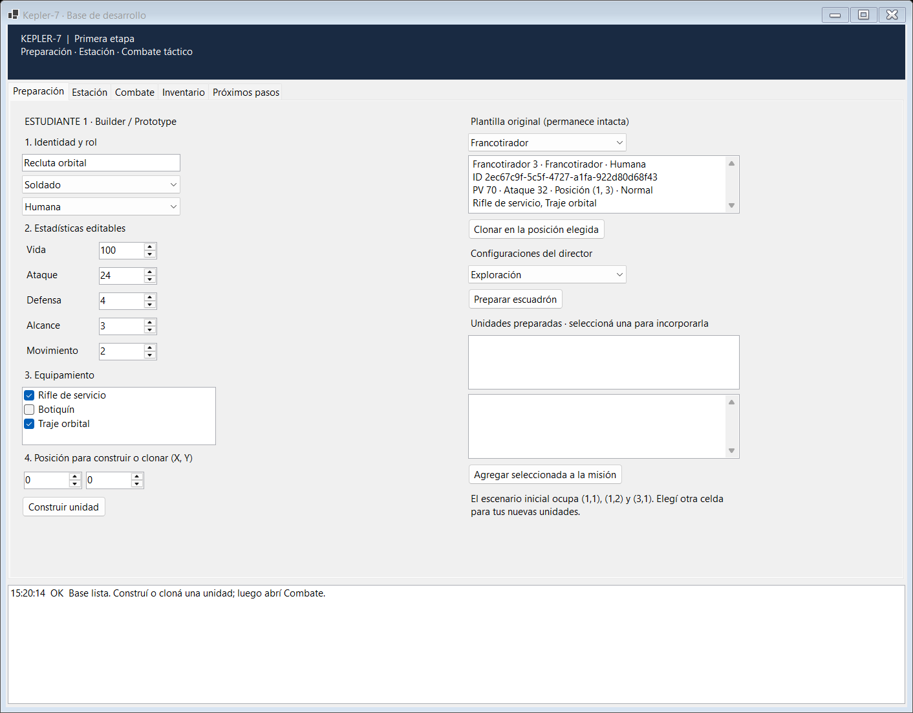
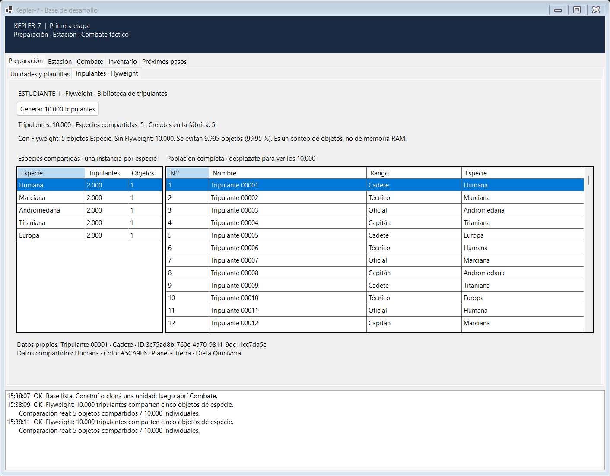
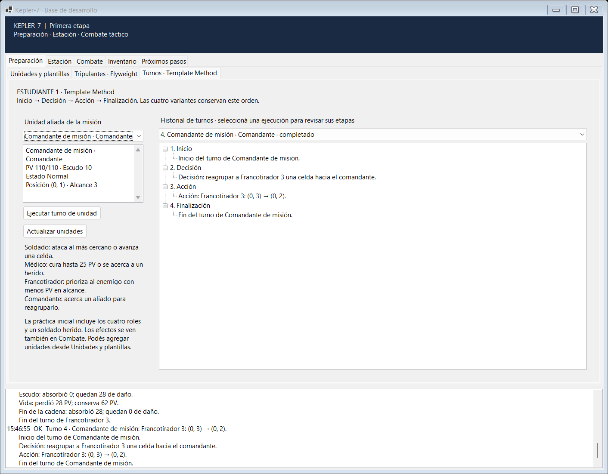
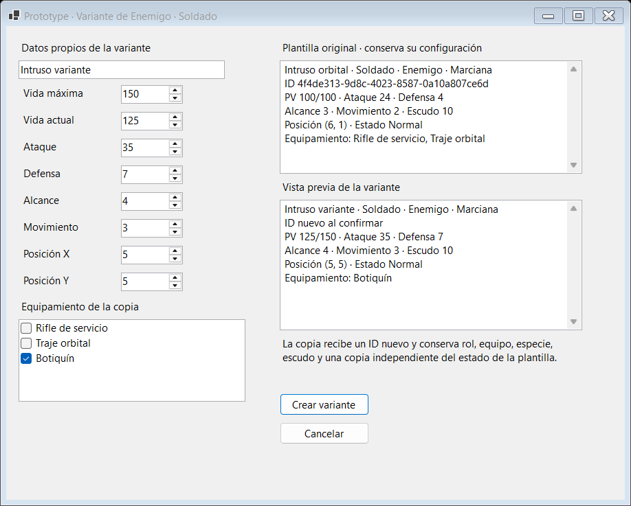
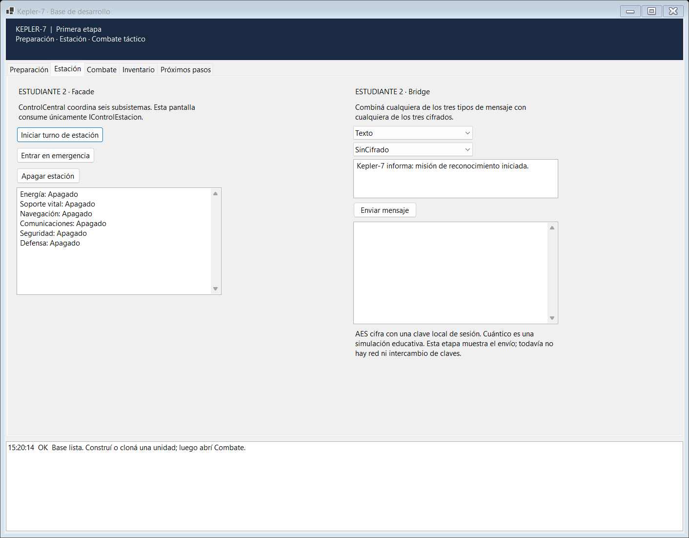
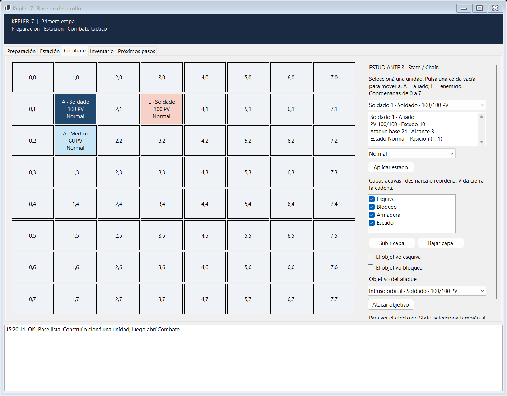

# Kepler-7

Base de un juego táctico por turnos para tres estudiantes, con Windows Forms y .NET 8. La solución separa las reglas en `Kepler7.Core` y la interfaz en `Kepler7.Game`, según el [enunciado del TP](https://docs.google.com/document/d/1vVW6Cx8qfFPTv6uYRMMYDLgfy0bxDR26ACcPQ2I3nQo).

## Empezar

Requisitos: Windows 10/11 y SDK de .NET 8. Para editar con diseñador, Visual Studio 2022 con la carga de desarrollo de escritorio de .NET.

Para abrir la aplicación, hacer doble clic en **Ejecutar.cmd**, ubicado en la raíz del repositorio. Este lanzador compila y ejecuta `Kepler7.Game` y conserva el mensaje de error en pantalla si no puede iniciarlo.

Desde la raíz del repositorio:

```powershell
dotnet build Kepler7.sln
dotnet run --project src/Kepler7.Game/Kepler7.Game.csproj
```

En Visual Studio, abrir `Kepler7.sln` y establecer **Kepler7.Game** como proyecto de inicio. El proyecto básico anterior se reorganizó en `src`; el comando de ejecución ahora apunta al proyecto de Windows Forms de esta solución.

Si Visual Studio indica que no se puede iniciar una biblioteca de clases, hacer clic derecho en **Kepler7.Game** en el Explorador de soluciones y elegir **Establecer como proyecto de inicio**. Después presionar **F5** o **Ctrl+F5**. `dotnet run` necesita la opción `--project` al ejecutarse desde la raíz, porque el archivo del proyecto está dentro de `src`.

El primer paso práctico es ejecutar la aplicación y recorrer **Preparación → Estación → Combate**. Luego seguir la tarea asignada en [Primera etapa](docs/PRIMERA_ETAPA.md).

## Qué incluye esta base

| Responsable | Patrones funcionales de esta etapa | Próximos patrones |
| --- | --- | --- |
| Estudiante 1 | Builder, Prototype, Flyweight y Template Method | Revisión de integración y documentación |
| Estudiante 2 | Bridge y Facade | Proxy y Strategy |
| Estudiante 3 | State y Chain of Responsibility | Command y Visitor |

- Preparación manual de unidades, dos escuadrones predefinidos con origen configurable y ocho plantillas: los cuatro roles en versiones aliadas y enemigas. Se pueden clonar o editar sus variantes sin alterar los originales.
- Biblioteca de 10.000 tripulantes con cinco especies compartidas, 2.000 tripulantes por especie y comparación real de cantidad de objetos frente a una población sin Flyweight.
- Cuatro turnos de unidad con orden fijo, acciones reales por rol e historial visible de inicio, decisión, acción y finalización.
- Tres tipos de mensaje y tres cifrados combinables. AES usa las bibliotecas de .NET; el cifrado cuántico es una simulación educativa.
- Una fachada que coordina Energía, Soporte Vital, Navegación, Comunicaciones, Seguridad y Defensa.
- Tablero de 8 × 8 con selección, movimiento, ataques, cuatro estados y una cadena de defensas que se puede configurar y reordenar.
- Registro visible de operaciones y de la resolución del daño.
- Contratos iniciales de los otros cuatro patrones, inventario y persistencia. Visitor tiene sus elementos y contratos; faltan los visitantes.

El escenario funciona en memoria. El ciclo automático de turnos, IA, deshacer/rehacer, bóveda, visitantes, progreso, guardado, tutorial y final de partida se completan en las siguientes etapas. El botón de iniciar turno de estación aún opera solo la fachada.

## Demostrar Flyweight del estudiante 1

Abrir **Preparación → Tripulantes · Flyweight** y pulsar **Generar 10.000 tripulantes**. La generación se ejecuta en segundo plano. La pantalla muestra los cinco objetos creados por la fábrica, su distribución y la población completa en una grilla virtual. Seleccionar una fila permite ver ID, nombre y rango propios junto con color, planeta y dieta compartidos.

La comparación crea una población equivalente sin compartir especies y cuenta referencias reales: **5 objetos con Flyweight frente a 10.000 individuales**. Se evitan 9.995 objetos de especie (99,95 %). Ese porcentaje compara objetos de especie; no es una medición de RAM ni del ahorro total del juego. Repetir la generación reemplaza la población y reutiliza las mismas cinco especies.

## Probar Template Method del estudiante 1

Abrir **Preparación → Turnos · Template Method**, seleccionar una unidad de la misión y pulsar **Ejecutar turno de unidad**. El rol elige automáticamente la subclase de `TurnoUnidad`, tanto para aliados como para enemigos. A la derecha se pueden consultar las cuatro etapas y volver a ejecuciones anteriores; los efectos se ven también en Combate.

Desde una nueva ejecución de la aplicación, esta secuencia permite probar los cuatro roles:

1. **Médico:** cura 25 PV al soldado de práctica, que pasa de 65 a 90 PV.
2. **Soldado:** ataca al intruso, que pasa de 100 a 90 PV después de sus defensas.
3. **Francotirador:** ataca al intruso, que pasa de 90 a 62 PV.
4. **Comandante:** reagrupa al francotirador desde `(0,3)` hasta `(0,2)`.

El soldado avanza una celda si no tiene un enemigo en alcance; el médico prioriza al aliado con mayor pérdida de vida en alcance y puede acercarse a un herido; el francotirador prioriza menos PV entre enemigos en alcance; el comandante acerca un aliado dentro de su alcance de mando. Si falta un objetivo válido, la unidad espera. Una unidad aturdida o caída omite su acción y conserva el registro de las cuatro etapas.

Las unidades que se construyen o clonan y se agregan a la misión aparecen en el selector de turnos. Cada clic ejecuta el turno individual de la unidad seleccionada. Para una respuesta manual del enemigo, seleccionar **Intruso orbital** y ejecutar su turno. La coordinación automática de rondas y decisiones enemigas pertenece a la integración posterior del juego.

## Probar Builder y Prototype del estudiante 1

En **Preparación → Unidades y plantillas**, el panel izquierdo permite construir una unidad por pasos. La posición X/Y también define el inicio de un escuadrón predefinido: con **(4,0)**, seleccionar Exploración o Asalto y pulsar **Preparar escuadrón**. Se preparan tres unidades en `(4,0)`, `(4,1)` y `(4,2)`; seleccionar cada una y agregarla a la misión. El escuadrón completo debe caber en el tablero.

Para Prototype, seleccionar cualquiera de las ocho plantillas del panel derecho. **Clonar en la posición elegida** conserva su configuración y asigna un ID nuevo. **Crear variante editable…** abre un editor con la plantilla y la vista previa juntas: permite cambiar nombre, vida actual/máxima, ataque, defensa, alcance, movimiento, posición y equipamiento. Conserva rol, equipo, especie, escudo y una copia independiente del estado de la plantilla.

Por ejemplo, elegir **Enemigo · Soldado**, crear una variante con 150 PV máximos, 125 PV actuales, ataque 35 y posición `(5,5)`, y agregarla a la misión. La plantilla original debe conservar 100/100 PV, ataque 24 y posición `(6,1)`. Las vistas muestran todos los datos de la unidad y se actualizan al regresar de Combate.

## Organización

```text
Kepler7.sln
src/
  Kepler7.Core/
    Modelos/       Identidades, estadísticas, unidades y misión
    Contratos/     Servicios que consumen las pantallas
    Datos/         Catálogo inicial para trabajar en memoria
    Patrones/      Una carpeta por cada uno de los doce patrones
    Servicios/     Preparación, turnos, comunicaciones y combate
  Kepler7.Game/
    Formularios/   MainForm y su diseñador
    Controles/     Preparación, tripulantes, turnos, estación, combate e inventario
    ComposicionAplicacion.cs
tests/
  Kepler7.Tests/   Comprobaciones ejecutables sin paquetes externos
docs/
  ARQUITECTURA.md
  PRIMERA_ETAPA.md
  PATRONES.md
```

Solo se utilizan bibliotecas incluidas en .NET. No hay paquetes NuGet de terceros. `Core` no referencia Windows Forms. Las pantallas invocan interfaces; `ComposicionAplicacion` conecta las implementaciones.

## Comprobar la base

```powershell
dotnet run --project tests/Kepler7.Tests/Kepler7.Tests.csproj
```

Es un ejecutable de comprobaciones con código de salida distinto de cero si algo falla; se ejecuta con `dotnet run`. Verifica clonación independiente, configuración incompleta, caché y concurrencia de Flyweight, población 10.000/5, regeneración y uso de las mismas especies en preparación. También verifica las nueve combinaciones de Bridge, la fachada, estados, orden y absorción de la cadena, movimiento e integración State → Chain. Para Template Method comprueba las cuatro etapas, los efectos de cada rol, alcance, vida máxima, espera, unidades bloqueadas, incorporación de unidades e historial. Core sigue separado de Windows Forms.

## Compilar para entregar

```powershell
dotnet publish src/Kepler7.Game/Kepler7.Game.csproj -c Release -r win-x64 --self-contained false -o artifacts/Kepler7
```

Distribuir toda la carpeta publicada. La computadora de destino debe tener el **.NET 8 Desktop Runtime x64**. Esta publicación corresponde al estado actual de desarrollo; antes de la entrega final deben completarse los pendientes del TP.

## Documentación y entrega

- [Arquitectura y contratos](docs/ARQUITECTURA.md).
- [Primera etapa, tareas de cada estudiante y criterios de cierre](docs/PRIMERA_ETAPA.md).
- [Mapa de los doce patrones y diagramas iniciales](docs/PATRONES.md).
- [Revisión de los requisitos del estudiante 1 y sus evidencias](docs/AUDITORIA_ESTUDIANTE_1.md).
- [Informe del estudiante 1: cuatro patrones, diagramas y pruebas desde la aplicación](docs/INFORME_ESTUDIANTE_1.md).

Para la entrega final: agregar los nombres de los tres estudiantes, capturas reales de las pantallas terminadas, completar los trece diagramas UML, el informe de hasta diez páginas y la presentación conjunta. La persistencia prevista es JSON en `%AppData%\Kepler7\`, a implementar detrás de `IRepositorioProgreso`.

## Capturas de la base

Pantallas renderizadas de la primera etapa. Se actualizarán al completar el recorrido de juego.












