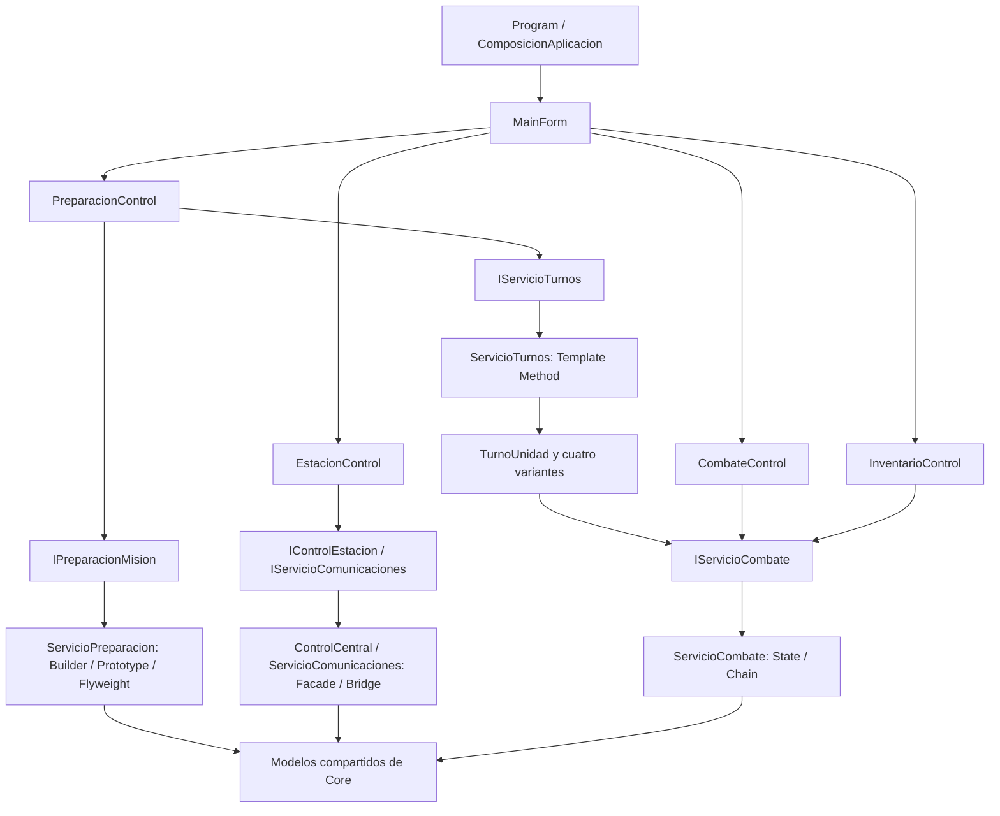

# Arquitectura de Kepler-7

La primera versión permite preparar un equipo y resolver acciones en un tablero de 8 × 8. Los tres estudiantes trabajan sobre modelos y contratos compartidos para integrar sus patrones sin introducir dependencias entre pantallas.

## Proyectos y dependencias

`Kepler7.Core` es una biblioteca `net8.0` sin controles visuales ni referencias a Windows Forms. `Kepler7.Game` es una aplicación `net8.0-windows`; presenta resultados, reúne entradas del usuario y conecta los servicios. `Kepler7.Tests` es un programa de consola opcional, sin paquetes de terceros, que verifica reglas del núcleo.

`MainForm` contiene la navegación y el registro. Cada módulo visual se entrega como `UserControl`. La representación del tablero está incluida inicialmente en `CombateControl`; se puede extraer a `TableroControl` cuando crezcan la selección, las animaciones o el dibujo, manteniendo el contrato de combate.

## Modelos acordados

| Tipo | Responsabilidad |
| --- | --- |
| `Unidad` | ID nuevo por instancia; nombre, equipo, rol, especie, estadísticas, estado, inventario y posición. Delega acciones en State. |
| `Estadisticas` | Vida actual/máxima, ataque, defensa, alcance y movimiento; vida limitada entre cero y su máximo. |
| `Posicion` | Coordenadas por valor; distancia Manhattan y comprobación de límites. Se usan coordenadas de 0 a 7. |
| `Mision` | Tablero, objetivo y colección compartida de unidades; no admite IDs ni posiciones vivas duplicados. |
| `IEspecie` / `Especie` | Datos comunes inmutables: nombre, color, planeta y dieta. `FabricaEspecies` conserva una instancia por nombre normalizado en un diccionario. |
| `Tripulante` | ID, nombre y rango propios; referencia a una de las cinco especies compartidas de la población de 10.000. |
| `Enemigo`, `ContextoCombate`, `AccionIA` | Entradas y salida previstas para las estrategias de IA. |
| `IItem` | Equipamiento por valor; acepta visitantes y se copia al clonar una unidad. |
| `ResultadoAccion` | Éxito/rechazo, mensaje y eventos que puede mostrar cualquier pantalla. |

Los nombres se mantienen sin tildes en identificadores de código y en español en la interfaz. Antes de cambiar una firma pública, revisar sus consumidores en los otros dos módulos y actualizar la documentación en el mismo cambio.

## Servicios y puntos de conexión

| Contrato | Operaciones | Estado |
| --- | --- | --- |
| `IPreparacionMision` | Crear unidad, consultar/clonar plantillas, crear variantes editadas, preparar escuadrones desde un origen y generar demostración de 10.000 tripulantes | Implementado por `ServicioPreparacion` |
| `IServicioTurnos` | Consultar unidades de ambos equipos, ejecutar manualmente el turno correspondiente al rol y consultar su historial por etapas | Implementado por `ServicioTurnos` |
| `IControlEstacion` | Iniciar turno de estación, emergencia, apagado y estado de los seis subsistemas | Implementado por `ControlCentral` |
| `IServicioComunicaciones` | Combinar tipo de mensaje y cifrado | Implementado por `ServicioComunicaciones` |
| `IServicioCombate` | Incorporar unidad, mover, atacar y cambiar estado | Implementado por `ServicioCombate` |
| `IServicioIA` | Cambiar estrategia y decidir una acción desde un contexto | Contrato para la siguiente etapa |
| `IServicioInventario` | Ejecutar un visitante sobre el inventario de una unidad de la misión | Contrato para la siguiente etapa |
| `IRepositorioProgreso` | Cargar/guardar progreso de forma asincrónica | Contrato; JSON en AppData en una etapa posterior |

La composición crea una sola misión compartida. Preparación incorpora unidades mediante `IServicioCombate`; los controles de combate e inventario muestran esa misma misión. El núcleo rechaza las posiciones ocupadas. Las pantallas no calculan daño, alcances ni permisos.

La fuente de especies del catálogo usa una `FabricaEspecies` compartida por preparación, recetas del director y escenario inicial. La fábrica normaliza espacios y mayúsculas, rechaza nombres desconocidos y protege la caché ante solicitudes concurrentes. `DemostradorFlyweight` utiliza esa misma fábrica para la población; las instancias individuales del escenario de comparación se crean fuera de la caché.

En Preparación, `TripulantesControl` ejecuta la generación con `Task.Run` y muestra una grilla virtual de 10.000 filas. Los conteos se calculan en Core por identidad de referencia, porque la igualdad por valor de `Especie` no demuestra que dos tripulantes apunten al mismo objeto. La comparación cuenta objetos de especie creados en escenarios equivalentes y no mide memoria RAM.

`ServicioTurnos` selecciona una de las cuatro subclases de `TurnoUnidad` por el rol de la unidad elegida, aliada o enemiga. `EjecutarTurno()` es público y no virtual: fija inicio → decisión → acción → finalización. Las subclases redefinen `Decidir()` y `Actuar()`. `ContextoTurno` consulta la misión y utiliza el contrato de combate existente para mover y atacar; la curación del médico usa las estadísticas del modelo. Los resultados se copian al historial como eventos tipados por etapa.

`TurnosUnidadControl` se integra como otra pestaña de Preparación y consume `IServicioTurnos`. Cada ejecución trabaja sobre las mismas unidades que muestra el tablero. La numeración del historial identifica ejecuciones individuales; no representa rondas globales. `MainForm` recibe los eventos y actualiza las vistas mediante los callbacks existentes.

`RegistroPrototipos` protege ocho plantillas: cuatro roles aliados y cuatro enemigos. `CrearVariante` utiliza `Unidad.ClonarConAjustes`, que primero clona y después cambia solo los datos propios de esa copia. Nombre y estadísticas tienen escritura privada; el original nunca se modifica. Las estadísticas, estado e inventario se copian de manera independiente; la especie inmutable conserva su referencia compartida. `VistaUnidad` ofrece una instantánea completa y copias del equipamiento para comparar el original y la variante sin exponer el registro.

`VarianteUnidadForm` permite editar y comparar la copia antes de incorporarla a la misión. Los escuadrones del director admiten un origen para ocupar tres celdas verticales; se valida que quepan en el tablero. El enemigo de la práctica inicial también se obtiene clonando su plantilla.

## Reglas iniciales del escenario

- La práctica inicial tiene un soldado aliado en `(1,1)` con 65/100 PV, un médico clonado en `(1,2)`, un francotirador clonado en `(0,3)`, un comandante en `(0,1)` y un enemigo en `(3,1)`. La herida inicial permite demostrar la curación.
- Movimiento y alcance usan distancia Manhattan, sin obstáculos ni búsqueda de caminos en esta etapa.
- Una unidad fuera de combate no se mueve ni ataca. Una celda con una unidad viva está ocupada.
- El equipo contrario puede seleccionarse manualmente para ensayar su respuesta; Strategy resolverá su decisión en la siguiente integración.
- `Normal` usa las estadísticas base. `Envenenado` reduce el ataque al 75 % y suma 2 al daño entrante positivo. `Aturdido` impide atacar y moverse. `Berserk` aumenta ataque al 150 % y daño recibido al 125 %, redondeando este último hacia arriba.
- State ajusta el daño entrante y luego se construye la cadena. Su orden inicial es Esquiva → Bloqueo → Armadura → Escudo → Vida. La esquiva anula el ataque; el bloqueo absorbe el 25 % del daño que le llega; la armadura resta defensa; el escudo se consume; vida recibe el resto.
- Las primeras cuatro capas se pueden desactivar o reordenar desde la pantalla. Vida siempre cierra la cadena. Cada ataque crea nuevos manejadores y registra el recorrido.
- La esquiva y el bloqueo se activan con opciones manuales para comparar resultados reproducibles. Las probabilidades y efectos por inicio de turno se definirán al integrar el ciclo de partida.
- El equipamiento se prepara y se puede inspeccionar. Sus valores todavía no modifican automáticamente las estadísticas; esa regla debe acordarse al integrar inventario y acciones.

Estas reglas permiten demostrar la integración inicial y fijar resultados comprobables; el balance de la partida se ajustará con el equipo.

## Turnos por rol

| Variante | Decisión | Acción del turno |
| --- | --- | --- |
| `TurnoSoldado` | Elegir al enemigo vivo más cercano | Atacar si está en alcance; de lo contrario, avanzar una celda libre hacia él |
| `TurnoMedico` | Priorizar la mayor pérdida de vida entre aliados vivos en alcance, incluido él mismo | Curar hasta 25 PV sin superar la vida máxima; si no hay un herido en alcance, acercarse una celda al más cercano |
| `TurnoFrancotirador` | Priorizar menos PV entre enemigos vivos en alcance | Disparar conservando la posición; esperar si no hay objetivo |
| `TurnoComandante` | Elegir el aliado vivo más alejado dentro de su alcance y a más de una celda | Acercar ese aliado una celda hacia el comandante, mediante el servicio de movimiento existente |

Se usa el nombre para desempatar candidatos equivalentes; una igualdad completa conserva el orden de la misión. Los desplazamientos buscan solo un paso libre que reduzca distancia, sin búsqueda de caminos. Si no existe una acción válida, la unidad espera. El turno de un actor caído o aturdido se registra con sus cuatro etapas y una acción omitida; el movimiento de un aliado también conserva las restricciones que ya aplica el servicio de combate.

La ejecución registra una sola acción efectiva. El historial conserva los mensajes y etapas tal como ocurrieron; sus consultas no restauran ni repiten acciones. El ciclo completo de rondas, respuesta enemiga y progreso se integra posteriormente.

## Integración siguiente

Command debe invocar los servicios de combate y guardar el estado anterior suficiente para restaurar vida, escudo, posición, estados e inventario. Deshacer un ataque no se resuelve solo devolviendo vida: hay que restaurar todas las unidades afectadas y el estado de la partida.

Strategy decide una `AccionIA`; el coordinador de turnos la convierte en un comando. Template Method conserva el orden inicio → decisión → acción → finalización. Facade inicia los sistemas de la estación y después se conecta al coordinador de partida; por ahora su botón no avanza un turno de combate.

Los cambios de módulo se conectan desde `ComposicionAplicacion`. Se pueden agregar eventos tipados de .NET para avisar cambios cuando haga falta; la base actual actualiza las vistas al ejecutar acciones o cambiar de pestaña. El ciclo definitivo deberá coordinar los turnos, XP, logros, victoria/derrota, guardado y pantalla final.

## Persistencia y límites del TP

Usar `System.Text.Json` detrás de `IRepositorioProgreso`, con ruta construida desde `Environment.SpecialFolder.ApplicationData` y subcarpeta `Kepler7`. Persistir primero XP y logros con un DTO y versión de formato; no serializar directamente controles ni servicios. Decidir por separado si se guardará una partida completa. Todavía no se lee ni escribe progreso.

No incorporar paquetes NuGet de terceros, motores de juego ni frameworks gráficos. Mantener las operaciones de archivo asincrónicas y las animaciones con `System.Windows.Forms.Timer` para que la interfaz responda.
