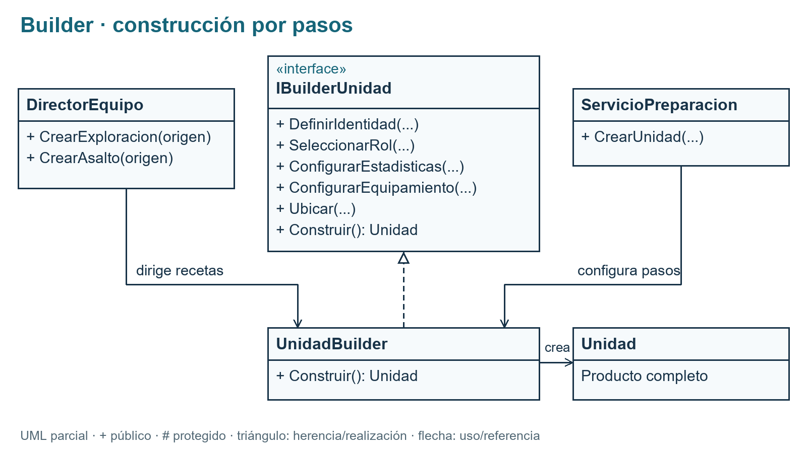
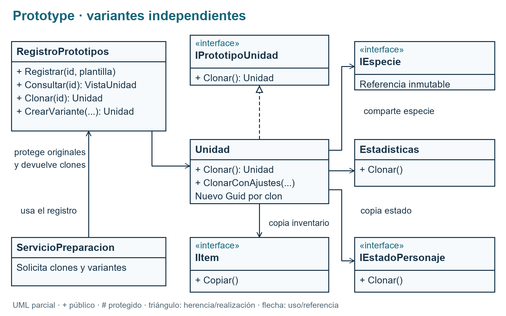
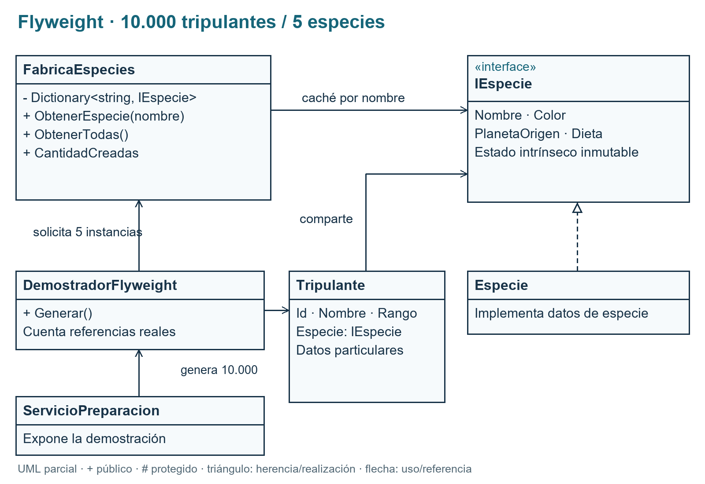
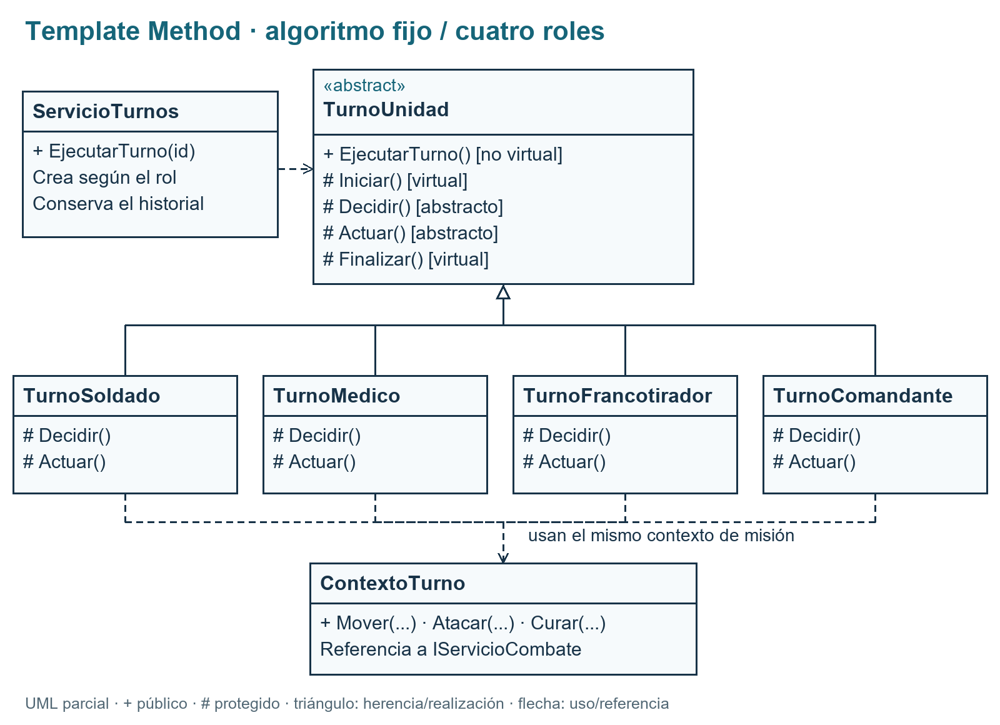

# Informe del estudiante 1

Responsable: **Herrera Devalle Juan Nicolás**. Actualización: **18 de octubre de 2026**.

Versión de la sección incorporada al [documento del trabajo](https://docs.google.com/document/d/1UYOV6m426KZ7vEkFXq81KrOXpsdLtndTOukTFsiiR5M). Requisitos: [enunciado del TP](https://docs.google.com/document/d/1vVW6Cx8qfFPTv6uYRMMYDLgfy0bxDR26ACcPQ2I3nQo), secciones 4.1.1, 4.1.2, 4.2.3, 4.3.5 y 11.3.

## Alcance

Los cuatro patrones del estudiante 1 están implementados e integrados en la preparación y la misión manual. Los apartados de los estudiantes 2 y 3 quedan pendientes en el informe. El juego completo, rondas automáticas, IA, progreso, persistencia, tutorial y victoria/derrota siguen sujetos a la integración conjunta.

## Ejecutar la aplicación

En Windows, abrir `Kepler7.sln` con Visual Studio, establecer **Kepler7.Game** como proyecto de inicio y presionar **F5**. También se puede abrir `Ejecutar.cmd` o ejecutar desde la raíz:

```powershell
dotnet run --project src/Kepler7.Game/Kepler7.Game.csproj
```

Requisitos: SDK de .NET 8; para el diseñador, Visual Studio 2022 con desarrollo de escritorio de .NET. Reabrir la aplicación reinicia el escenario en memoria.

## Builder — armado de unidades y escuadrones

Implementado — Estudiante 1. Resuelve la construcción de unidades con distintas configuraciones sin concentrar todos los parámetros en la pantalla. IBuilderUnidad define identidad, rol, estadísticas, equipamiento, ubicación y Construir(); UnidadBuilder entrega una Unidad completa. ServicioPreparacion coordina los pasos. UML: figura A1.

Se validan identidad, rol, valores estadísticos, datos nulos y límites del tablero 8 × 8; una configuración incompleta se rechaza. Las estadísticas y los ítems se copian para evitar referencias mutables del cliente. DirectorEquipo ofrece Exploración (Soldado, Médico y Francotirador) y Asalto (Comandante y dos Soldados), con origen configurable y tres celdas verticales.

**Cómo probarlo — Preparación → Unidades y plantillas:**

1. Completar el panel izquierdo, elegir posición (0,0) y construir. La vista previa debe conservar nombre, rol, especie, estadísticas, inventario y posición ingresados; agregar la unidad a la misión y verla en Combate.

2. Elegir origen (4,0), preparar Exploración y agregar sus tres integrantes. Deben aparecer en (4,0), (4,1) y (4,2). Reabrir la aplicación y repetir con Asalto para comprobar la segunda receta.

3. Intentar preparar un escuadrón desde (4,7): debe rechazarse porque no caben sus tres celdas. No se incorpora un equipo parcial.



Fuentes: [SVG](diagramas/builder.svg), [Mermaid](diagramas/builder.mmd).

## Prototype — plantillas de unidades

Implementado — Estudiante 1. Permite generar variantes de una unidad preparada. Unidad implementa IPrototipoUnidad.Clonar(); RegistroPrototipos busca por identificador y protege las plantillas guardando una copia privada. Hay ocho plantillas: Soldado, Médico, Francotirador y Comandante, en versiones aliadas y enemigas. El intruso inicial también procede de un prototipo. UML: figura A2.

Cada clon obtiene un Guid nuevo y copias independientes de estadísticas, lista de inventario, ítems y estado; posición y escudo se conservan por valor. Solo se comparte la especie inmutable. ClonarConAjustes parte de Clonar(), sin reconstruir por Builder. VarianteUnidadForm permite editar nombre, vida actual/máxima, ataque, defensa, alcance, movimiento, posición y equipamiento; conserva rol, equipo y especie.

**Cómo probarlo — Preparación → Unidades y plantillas:**

1. Elegir Enemigo · Soldado y abrir Crear variante editable… Comparar la plantilla original y la vista previa dentro del mismo editor.

2. Configurar «Intruso variante»: vida máxima 150, actual 125, ataque 35, defensa 7, alcance 4, movimiento 3, posición (5,5) y solo un botiquín. Aceptar y agregarlo a la misión. Debe tener otro ID; el original conserva 100/100 PV, ataque 24 y posición (6,1).

3. Mover la variante a (5,4) en Combate y volver a Preparación: su vista cambia y la plantilla sigue intacta. El editor rechaza un nombre vacío. Clonar en la posición elegida también debe generar una unidad con identidad nueva.



Fuentes: [SVG](diagramas/prototype.svg), [Mermaid](diagramas/prototype.mmd).

## Flyweight — catálogo de tripulantes

Implementado — Estudiante 1. Evita repetir los datos de especie de cada tripulante. IEspecie y el record inmutable Especie contienen nombre, color, planeta de origen y dieta (estado intrínseco). Tripulante conserva su ID, nombre y rango (datos particulares) y referencia una especie compartida. UML: figura A3.

FabricaEspecies usa Dictionary<string, IEspecie>, normaliza nombres y protege la creación concurrente con un bloqueo. El catálogo contiene Humana, Marciana, Andromedana, Titaniana y Europa. DemostradorFlyweight genera 10.000 tripulantes, 2.000 por especie, y una población equivalente sin compartir. Cuenta referencias reales, no igualdad por valor: 5 frente a 10.000 objetos de especie; se evitan 9.995 (99,95 %). Es una comparación de objetos de especie, no una medición de RAM.

**Cómo probarlo — Preparación → Tripulantes · Flyweight:**

1. Pulsar Generar 10.000 tripulantes. Al finalizar deben verse 10.000 filas, cinco especies y 2.000 tripulantes por especie; la generación se ejecuta en segundo plano.

2. Seleccionar varias filas y recorrer la grilla virtual: cada tripulante tiene identidad propia; los de igual especie comparten color, planeta y dieta. La comparación debe mostrar 5 instancias compartidas y 10.000 sin Flyweight.

3. Regenerar: cambian los tripulantes y sus IDs, mientras el contador de la fábrica permanece en cinco. Esta población es una demostración en Preparación; no ocupa 10.000 casillas del tablero.



Fuentes: [SVG](diagramas/flyweight.svg), [Mermaid](diagramas/flyweight.mmd).

## Template Method — turno de unidad

Implementado — Estudiante 1. TurnoUnidad fija el algoritmo en EjecutarTurno(), público y no virtual: inicio → decisión → acción → finalización. Iniciar() y Finalizar() son virtuales; Decidir() y Actuar(), abstractos. Las cuatro subclases varían esos pasos sin reemplazar el orden. UML: figura A4.

TurnoSoldado ataca al enemigo más cercano en alcance o avanza una celda libre; TurnoMedico cura hasta 25 PV al aliado vivo con más vida perdida en alcance o se acerca a un herido; TurnoFrancotirador dispara al enemigo con menos PV dentro de su alcance; TurnoComandante acerca una celda al aliado más distante que pueda reagrupar dentro del alcance de mando. Sin objetivo válido se espera. Un actor caído o aturdido omite su acción y conserva las cuatro etapas.

ServicioTurnos selecciona la subclase por rol para ambos equipos y conserva el historial por etapas. ContextoTurno aplica ataques, movimientos y curaciones a las mismas unidades de la misión que muestra Combate. La ejecución es manual por unidad; la coordinación automática de rondas queda pendiente para la integración del equipo.

**Cómo probarlo — Reabrir la aplicación y entrar en Preparación → Turnos · Template Method. Ejecutar una vez cada unidad, en este orden:**

1. Médico: el Soldado pasa de 65 a 90 PV.

2. Soldado: Intruso orbital pasa de 100 a 90 PV después de sus defensas.

3. Francotirador: el intruso pasa de 90 a 62 PV.

4. Comandante: el Francotirador se mueve de (0,3) a (0,2). Revisar en cada turno Inicio, Decisión, Acción y Finalización, y contrastar los efectos en Combate. Seleccionar luego Intruso orbital permite ejecutar manualmente su respuesta; el Soldado pasa de 90 a 80 PV.



Fuentes: [SVG](diagramas/template-method.svg), [Mermaid](diagramas/template-method.mmd).

## Verificación registrada

La [auditoría del estudiante 1](AUDITORIA_ESTUDIANTE_1.md) registra compilación Release sin errores ni advertencias, 35 comprobaciones del núcleo y el recorrido de interfaz de construcción, escuadrones, variante enemiga, Flyweight 10.000/5 y turnos de los dos equipos. Son resultados de la revisión del 18 de octubre; no acreditan todavía una partida completa con cierre.

Las comprobaciones están en `Program.cs`, `Estudiante1AuditTests.cs` y `TemplateMethodTests.cs`. Se ejecutan, sin paquetes externos, mediante:

```powershell
dotnet run --project tests/Kepler7.Tests/Kepler7.Tests.csproj --configuration Release
```

Capturas: [Flyweight](capturas/flyweight-tripulantes.png), [turnos](capturas/template-method-turnos.png) y [variante Prototype](capturas/prototype-variante.png).

## Diagramas y pendientes

Los diagramas son vistas parciales de las clases que intervienen en cada patrón; omiten miembros auxiliares. `IItem` e `IEstadoPersonaje` aparecen en Prototype como dependencias de la copia; su desarrollo sigue a cargo del estudiante 3. Para regenerar PNG, SVG y las fuentes Mermaid, usar Python 3 con Pillow y ejecutar `python docs/diagramas/generar_estudiante_1.py`. Es una herramienta de documentación, no una dependencia del juego.

- **Estudiante 2:** Bridge, Facade, Proxy y Strategy: documentación, UML, evidencias y aportes pendientes de su responsable.
- **Estudiante 3:** Command, Chain of Responsibility, State y Visitor: documentación, UML, evidencias y aportes pendientes de su responsable.
- **Equipo:** diagrama general definitivo, ocho diagramas restantes, recorrido completo, persistencia, tutorial, progreso y final de partida; completar conclusiones y entregables después de integrar el trabajo.
