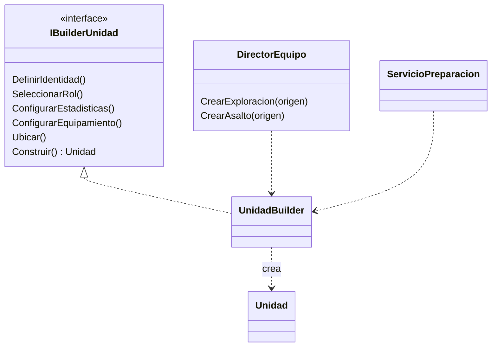
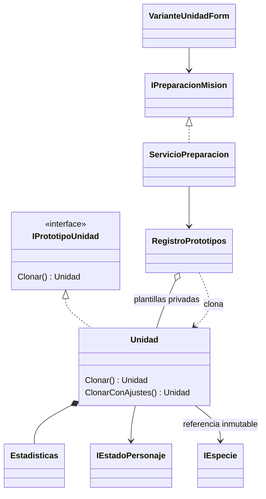
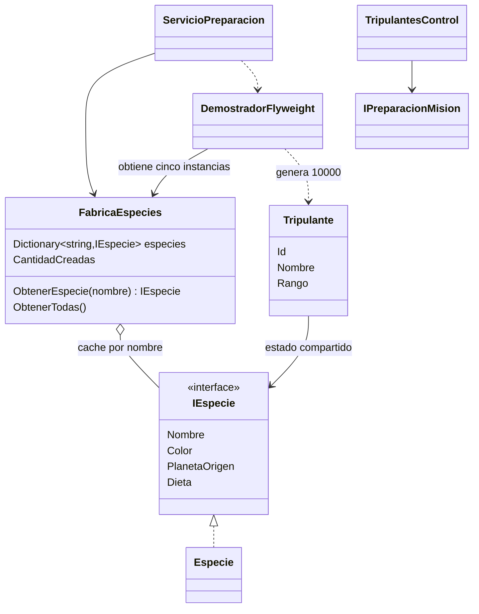
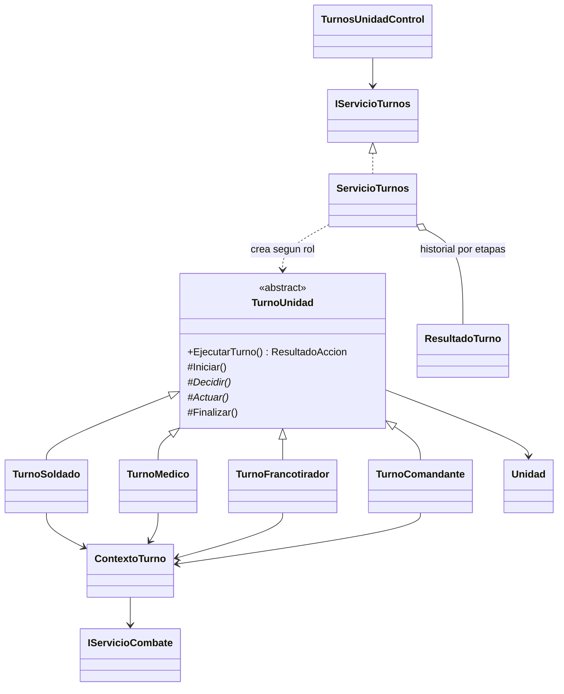
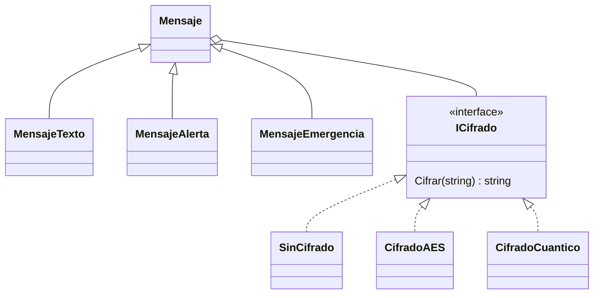
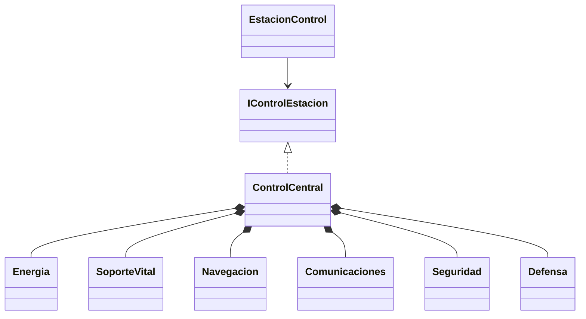
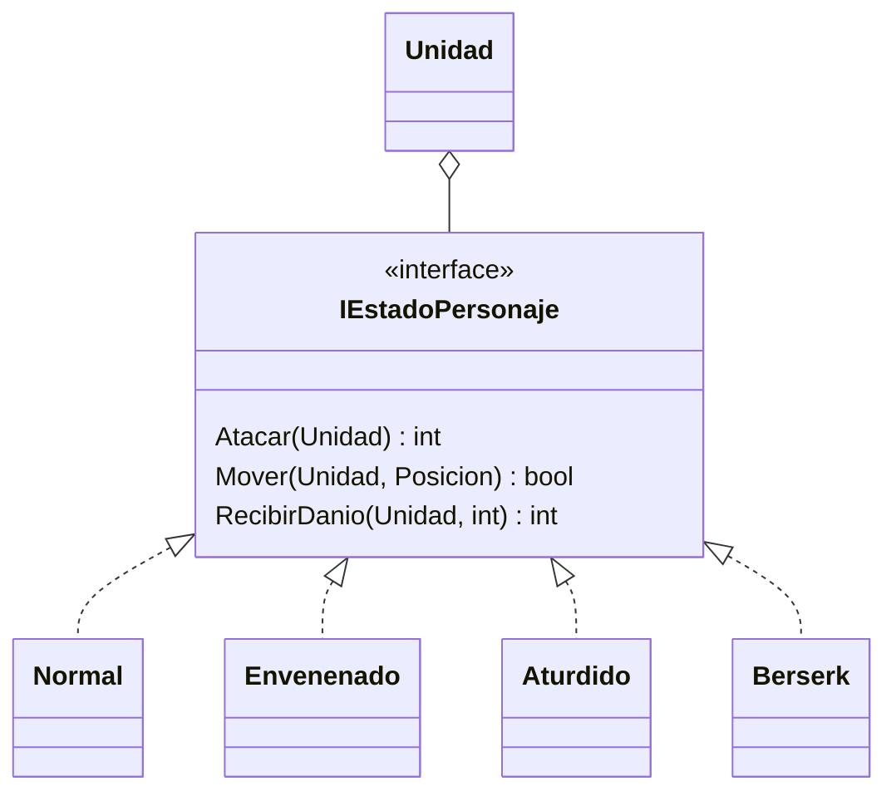
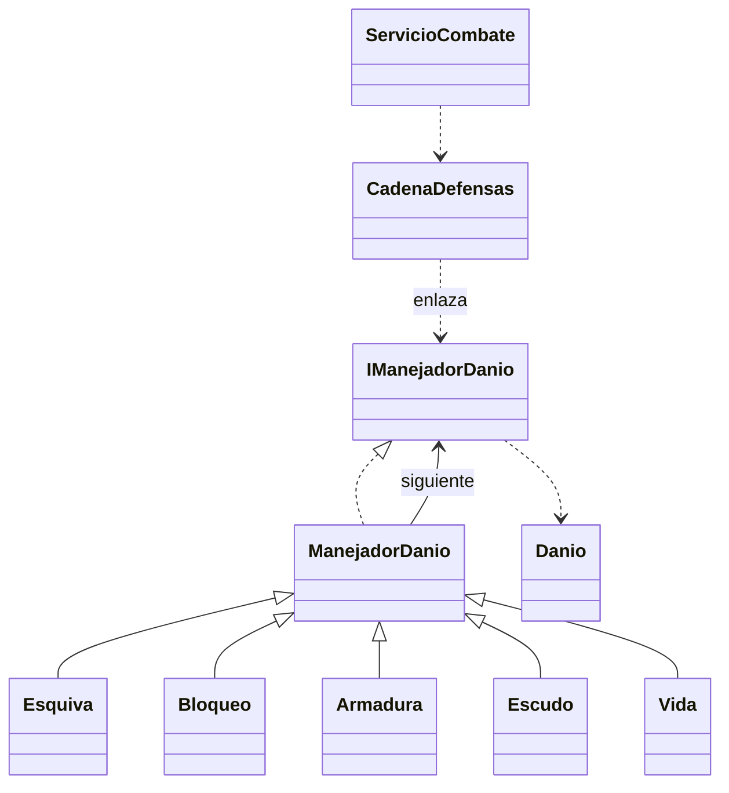

# Patrones de Kepler-7

Los seis patrones de la primera etapa, Flyweight y Template Method del estudiante 1 tienen implementaciones funcionales en un escenario manual. Los restantes tienen modelos y contratos para continuar; su presencia en una carpeta no representa un requisito completo del TP.

## Mapa y estado

| Patrón | Responsable | Clases/contratos | Uso actual o entrega siguiente |
| --- | --- | --- | --- |
| Builder | 1 | `IBuilderUnidad`, `UnidadBuilder`, `DirectorEquipo` | Funcional: configuración manual, validaciones, vista completa y dos escuadrones con origen configurable |
| Prototype | 1 | `IPrototipoUnidad`, `Unidad.Clonar`, `Unidad.ClonarConAjustes`, `RegistroPrototipos` | Funcional: ocho plantillas aliadas/enemigas y editor de variantes independientes |
| Flyweight | 1 | `IEspecie`, `Especie`, `FabricaEspecies`, `Tripulante`, `DemostradorFlyweight` | Funcional: 10.000 tripulantes / cinco instancias; comparación de objetos y grilla en Preparación |
| Template Method | 1 | `TurnoUnidad`, `TurnoSoldado`, `TurnoMedico`, `TurnoFrancotirador`, `TurnoComandante` | Funcional: cuatro variantes con acciones sobre la misión e historial por etapas en Preparación |
| Bridge | 2 | `Mensaje`, tres mensajes y tres `ICifrado` | Funcional: nueve combinaciones y cambio de implementación |
| Facade | 2 | `ControlCentral`, seis subsistemas internos | Funcional: inicio, emergencia y apagado |
| Proxy | 2 | `IBoveda`, `Usuario`, `RolUsuario` | Faltan bóveda, permisos y auditoría persistente |
| Strategy | 2 | `IEstrategiaIA`, `IServicioIA`, `ContextoCombate`, `AccionIA` | Faltan cuatro estrategias, intercambio y respuesta enemiga |
| Command | 3 | `IComando` | Faltan cuatro comandos, gestor, historial y deshacer/rehacer |
| Chain of Responsibility | 3 | `IManejadorDanio`, cinco manejadores, `CadenaDefensas` | Funcional: daño con capas configurables y registro |
| State | 3 | `IEstadoPersonaje`, cuatro estados, `Unidad` | Funcional: modifica ataque, movimiento y daño entrante |
| Visitor | 3 | `IItem`, `IVisitor`, `Arma`, `Pocion`, `Armadura` | Elementos y doble despacho base; faltan visitantes y aplicación visible |

## Builder

Se usa al elegir las partes de una unidad nueva. El formulario reúne la configuración; `ServicioPreparacion` dirige los pasos del builder y recibe el producto completo. El director reúne recetas de equipos sin duplicar la construcción.

El director ofrece Exploración y Asalto. El origen elegido ubica las tres unidades en celdas verticales consecutivas; valida el espacio dentro del tablero. La vista previa muestra rol, equipo, especie, identidad, estadísticas completas, posición, estado, escudo e inventario.

## Prototype

Se usa al partir de una plantilla ya configurada. El registro protege el original y devuelve copias. Cada copia tiene ID, estadísticas, inventario, posición y estado independientes; comparte solo los datos inmutables de la especie.

Existen cuatro plantillas aliadas y cuatro enemigas. El editor permite cambiar nombre, vida actual/máxima, ataque, defensa, alcance, movimiento, posición y equipamiento sin reconstruir la unidad con Builder. `ClonarConAjustes` parte de `Clonar()` y conserva rol, equipo, especie, escudo y una copia independiente del estado. La plantilla y la variante se muestran juntas; el enemigo inicial de la misión también utiliza Prototype.

## Flyweight

`Tripulante` mantiene su ID, nombre y rango como datos particulares. Nombre, color, planeta y dieta de la especie son inmutables y se comparten mediante `IEspecie`. `FabricaEspecies` conserva un `Dictionary<string, IEspecie>` y devuelve el mismo objeto para pedidos repetidos, ignorando mayúsculas y espacios en los extremos. Solo admite las cinco especies del catálogo; un bloqueo protege la creación ante solicitudes simultáneas.

La fuente común de preparación y las recetas del director obtienen sus especies de esta fábrica. `DemostradorFlyweight` genera 10.000 tripulantes, distribuidos en 2.000 por especie. Crea también una población equivalente con 10.000 especies individuales, cuenta referencias usando `ReferenceEqualityComparer` y conserva la población compartida para inspeccionarla. La comparación reduce los objetos de especie de 10.000 a cinco, un 99,95 %; no representa una medición de memoria RAM.

La demostración se abre desde **Preparación → Tripulantes · Flyweight**. La grilla virtual permite recorrer la población completa y distinguir datos propios y compartidos. Regenerar reemplaza los tripulantes y reutiliza las cinco especies de la fábrica.

## Template Method

El método público y no virtual `TurnoUnidad.EjecutarTurno()` conserva el orden inicio → decisión → acción → finalización. `Iniciar()` y `Finalizar()` tienen implementaciones comunes; `Decidir()` y `Actuar()` son abstractos. Las cuatro subclases eligen sus objetivos y efectos sin reemplazar el algoritmo general.

Soldado ataca o avanza; Médico cura hasta 25 PV o se acerca a un herido; Francotirador prioriza al enemigo con menos PV en alcance; Comandante acerca un aliado a su posición. Una unidad caída o aturdida registra el turno completo con una acción omitida. Los turnos sin objetivos registran una espera.

`ServicioTurnos` crea la variante según el rol y conserva copias de sus eventos. `ContextoTurno` conecta las acciones al contrato de combate existente y al modelo de estadísticas. La pantalla **Preparación → Turnos · Template Method** permite ejecutar manualmente y revisar los turnos de unidades aliadas y enemigas; sus efectos se reflejan en el mismo tablero de la misión.

## Bridge

Los tipos de mensaje y los mecanismos de cifrado varían por separado. La abstracción `Mensaje` contiene un `ICifrado` intercambiable, evitando nueve clases para las combinaciones. El cifrado cuántico se identifica como simulación en la interfaz.

## Facade

El cliente opera la estación con tres métodos sencillos. `ControlCentral` conserva y coordina los seis subsistemas; sus tipos internos no se exponen a Windows Forms. La fachada devuelve eventos y vistas del estado para mostrarlos.

## State

`Unidad` delega su comportamiento en el estado actual. El servicio no contiene un condicional por cada estado para resolver la acción. El estado puede sustituirse durante el escenario y su efecto llega a las reglas de movimiento, ataque y daño entrante.

## Chain of Responsibility

Cada manejador resuelve su parte del daño y lo pasa al siguiente si queda una cantidad pendiente. `CadenaDefensas` crea una cadena por ataque con el orden elegido en la pantalla; Vida es el cierre obligatorio. Si una capa absorbe todo, el recorrido termina allí.

Estos ocho diagramas y el esquema general de arquitectura son versiones iniciales. Al completar cada patrón pendiente, agregar su diagrama y revisar todos contra las clases y relaciones finales para llegar a los trece solicitados.
